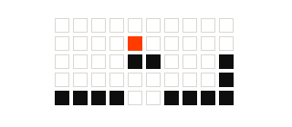
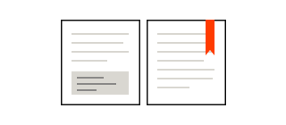
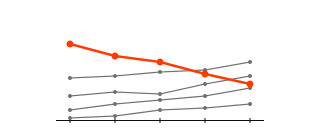

::: {.byline-strip}
{.byline-photo}

[**Mete Akcaoglu** · Professor of Instructional Technology and Department Chair, Georgia Southern University. I study how people learn with and through technology. [About me →](about.html)]{.byline-text}
:::

::: {#stories}
:::

[→ All posts](blog.html){.front-all}

::: {.section-header}
## Selected Work [Programs · Tools]{.section-kicker}

[→ All projects](projects.html){.section-cta}
:::

```{=html}
<div class="feature-grid">
  <a class="feature-card" href="projects.html#project-game">
    
    <span class="feature-kicker">NSF · $299,895 · 2020–2022</span>
    <span class="feature-title">Project GAME</span>
    <span class="feature-teaser">An NSF-funded middle school computer science curriculum that teaches programming through game design in Unity 3D.</span>
  </a>
  <a class="feature-card" href="projects.html#book">
    
    <span class="feature-kicker">Book · 2026</span>
    <span class="feature-title">Computational Analysis of Educational Data</span>
    <span class="feature-teaser">A field guide to computational methods in R for education researchers.</span>
  </a>
  <a class="feature-card" href="projects.html#timeline-prototype">
    
    <span class="feature-kicker">HTML · 2026</span>
    <span class="feature-title">Project Timeline Prototype</span>
    <span class="feature-teaser">A course project laid out as one timeline, with a rule for AI use at each step.</span>
  </a>
  <a class="feature-card" href="projects.html#program-comparator">
    
    <span class="feature-kicker">R · 2026</span>
    <span class="feature-title">Program Comparator Analysis</span>
    <span class="feature-teaser">Benchmarks my department's twelve graduate programs against every comparable program in the University System of Georgia.</span>
  </a>
</div>
```

::: {.section-header}
## News

[→ All news](about.html#news){.section-cta}
:::

::: {#news}
:::
