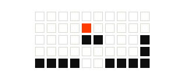
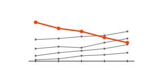

::: {.home-intro}
:::: {.home-intro-id}
{.home-intro-photo}

[Mete Akcaoglu]{.home-intro-name}
[Professor & Chair · Georgia Southern]{.home-intro-role}
::::

:::: {.home-intro-bio}
I am a professor of instructional technology and chair of the Department of Leadership, Technology, and Human Development at Georgia Southern University. I study how people learn with and through technology, with a focus on motivation, interest, and the design of learning environments.

[Now]{.home-intro-now} I'm working on what learners should and shouldn't hand to AI, and on online courses built around the learner's work.

[[CV](cv.html) · [Google Scholar](https://scholar.google.com/citations?user=0y1b0oEAAAAJ&hl=en) · [Email](mailto:makcaoglu@georgiasouthern.edu) · [About&nbsp;me&nbsp;→](about.html)]{.home-intro-links}
::::
:::

::: {.section-header}
## Latest Writing

[→ All posts](blog.html){.section-cta}
:::

::: {#stories}
:::

::: {.home-rails}
:::: {.home-rail}
::::: {.section-header}
## Selected Work

[→ All projects](projects.html){.section-cta}
:::::

```{=html}
<div class="work-list">
  <a class="work-row" href="projects.html#project-game">
    
    <span class="work-text">
      <span class="feature-kicker">NSF · $299,895 · 2020–2022</span>
      <span class="work-title">Project GAME</span>
      <span class="work-teaser">An NSF-funded middle school computer science curriculum that teaches programming through game design in Unity 3D.</span>
    </span>
  </a>
  <a class="work-row" href="projects.html#book">
    
    <span class="work-text">
      <span class="feature-kicker">Book · Chapman & Hall/CRC · 2027</span>
      <span class="work-title">Computational Analysis of Educational Data</span>
      <span class="work-teaser">A field guide to computational methods in R for education researchers.</span>
    </span>
  </a>
  <a class="work-row" href="projects.html#timeline-prototype">
    
    <span class="work-text">
      <span class="feature-kicker">HTML · 2026</span>
      <span class="work-title">Project Timeline Prototype</span>
      <span class="work-teaser">A course project laid out as one timeline, with a rule for AI use at each step.</span>
    </span>
  </a>
  <a class="work-row" href="projects.html#program-comparator">
    
    <span class="work-text">
      <span class="feature-kicker">R · 2026</span>
      <span class="work-title">Program Comparator Analysis</span>
      <span class="work-teaser">Benchmarks my department's twelve graduate programs against every comparable program in the University System of Georgia.</span>
    </span>
  </a>
</div>
```
::::

:::: {.home-rail}
::::: {.section-header}
## News & Papers

[→ All news](about.html#news){.section-cta}
:::::

::: {#news}
:::
::::
:::
