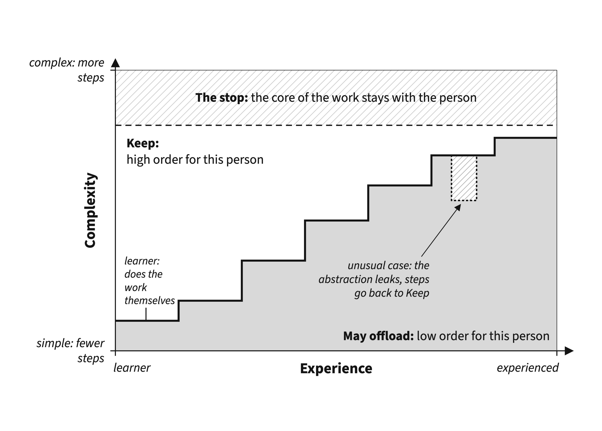

This is my first preprint, and my first conceptual piece.

As we see AI taking over student work (and of course professional work), I have been thinking about a good way to think about its integration. Going back to theories in education (and recent studies on AI and learning), I drafted this piece and am sharing it as a preprint. It grew out of two earlier posts here, [The Radiology Lesson](../2026-05-19-radiology-lesson/index.qmd) and [Beyond the Panic](../2026-05-19-beyond-the-panic/index.qmd).

The big idea is in the figure below. Tech-human partnership has always existed, but with AI, the cognitive partnership can be dangerous as well as helpful. I suggest that offloading happens on a ladder, and a task's order depends on the person: it is high order while they still have to figure out what to do, and low order once they know how. Once a task becomes low order for a person, they can offload that part to technology, until they reach the core, which depends on the person and the job.

{fig-alt="Diagram of the Offloading Ladder: as experience with a task grows, more of it becomes low order and can be offloaded to AI, up to the core of the work, which stays with the person."}

For learners, classrooms and courses need to determine the core and keep it off AI. AI companies need a better way to protect human learning.

**Preprint (EdArXiv):** Akcaoglu, M. (2026). *The Offloading Ladder: How Experience Changes What Learners and Practitioners Should Hand to Artificial Intelligence.* <https://doi.org/10.35542/osf.io/ys2fu_v1>

---

*How I used AI.* Since the piece is about AI, let's talk about it too. As I make the case in the paper, AI usage also ranges from low order to high order, and I believe I kept the high-order work for myself. I started from my initial idea and outline. I used Undermind to search the literature and Claude Code to gather notes from my readings (my highlights in Zotero). Over many sessions, I built the paper step by step, creating each paragraph and argument and using Claude Code to shape paragraphs from my arguments and reading notes, and I edited and rewrote each draft along the way. Claude Code also checked references and accuracy. I used Claude Design to draw the figure. Going back to the ladder, I kept the core (the idea and editorial ownership), and Claude Code helped with tasks that were low order for me, like pulling my highlights into my outline.
