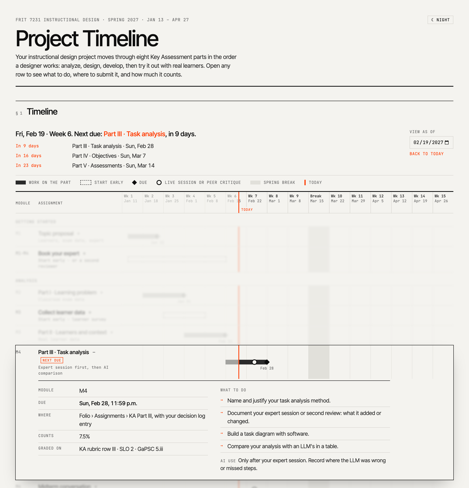

Every learning management system I know is a content management system, unfortunately (Brown et al., 2015). Instructors upload modules, files, discussion boards, and a gradebook, and the course takes the shape of those folders.

A learner needs to see two things in a course: their work over time and the people doing it with them. Students piece the first together from module pages and due dates, because the folders hide the shape of the project. For the second, the LMS offers little. Social presence grows when the design supports it, through small groups and through spaces students already use, such as Facebook groups (Lee & Akcaoglu, 2017). Discussion boards crept in to fill the social gap. They did a poor job of reflecting the buzz of a classroom, and lately most students' posts read as AI-generated.

I imagine a learning-focused layout with two parts. The work sits in the middle as a timeline of the course project, and each step opens into what to do, where to submit it, how much it counts, and how AI may be used at that step. The people sit on the side in an activity feed, where students share finds, questions, moments when AI helped or misled them, and updates on their work. Finishing a step on the timeline posts an update to the feed, so the work and the people stay connected.

I built the timeline for my Instructional Design course (FRIT 7231), and it runs as a page inside our LMS. For now, the timeline and the feed will be part of the existing course, a layer on top of the content system. The feed is designed and still to be built.

{fig-alt="A Gantt-style course timeline. Each assignment is a row across the 15-week term, with a red line marking today. One row, Part III Task analysis, is open and shows its due date, where to submit it, its weight, what to do, and the rule for AI use: only after the expert session."}

[Open the working prototype](https://claude.ai/artifact/8jXYsPCujKgBVyVsPinQqj){target="_blank"}

If you teach online and are trying something similar, I would like to hear how it goes.

**Cite this post:** Akcaoglu, M. (2026). *Learning-Focused Design for the LMS* (Version 1). Zenodo. <https://doi.org/10.5281/zenodo.23773997>

**References**

Brown, M., Dehoney, J., & Millichap, N. (2015). *The next generation digital learning environment: A report on research* [ELI Paper]. EDUCAUSE. <https://library.educause.edu/resources/2015/4/the-next-generation-digital-learning-environment-a-report-on-research>

Lee, E., & Akcaoglu, M. (2017). Sociability of online learning environments. In J. M. Spector, B. B. Lockee, & M. D. Childress (Eds.), *Learning, design, and technology*. Springer. <https://doi.org/10.1007/978-3-319-17727-4_39-2>
